<div align="center">

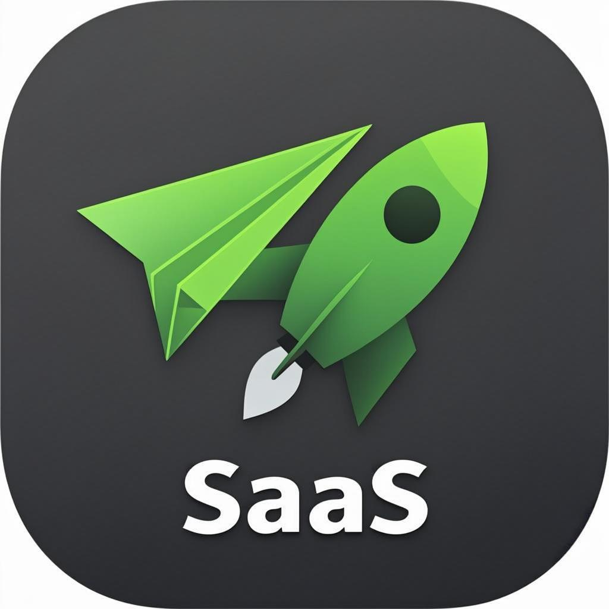

# 🚀 JobPilot AI

### *Your autonomous job-application co-pilot.*

**Connect your job portals once — let the engine scan, score, and apply for you 24/7.**

[](https://nextjs.org)
[](https://www.typescriptlang.org)
[](https://python.org)
[](https://fastapi.tiangolo.com)
[](https://laravel.com)
[](https://prisma.io)
[](https://tailwindcss.com)
[](LICENSE)


</div>

---

## 🎯 What is JobPilot AI?

JobPilot AI is a **full-stack autonomous job-application platform**. You connect your job-portal
accounts — **Indeed, LinkedIn, Glassdoor, ZipRecruiter, Monster, Naukri** — and the auto-pilot
engine takes over:

> 🔍 **Scans** every new listing across your portals → 🧠 **Scores** each job against your profile
> (skills, salary, location, role fit) → ✍️ **Writes** a tailored cover letter → 📨 **Applies** for
> you — within your daily limits and rules → 📊 **Tracks** every application through the pipeline.

No more 2 a.m. "Easy Apply" marathons. Set your rules once. Ship resumes while you sleep.

## ✨ Feature Highlights

| | Feature | What it does |
|---|---|---|
| 🤖 | **Auto-Pilot Engine** | Fully automatic apply-cycles with daily limits, min-match threshold, active hours and quiet hours |
| 🔌 | **Portal Hub** | Connect / disconnect / sync Indeed, LinkedIn, Glassdoor, ZipRecruiter, Monster & Naukri accounts |
| 🎯 | **Smart Match Scoring** | Transparent 0–100 score: skill overlap, role fit, salary fit, location & remote fit — with reasons |
| ✍️ | **AI Cover Letters** | A tailored, professional cover letter generated per application |
| 📊 | **Application Tracker** | Full pipeline (Applied → Screening → Interview → Offer) with per-application timeline & used cover letter |
| 🧭 | **Job Discovery** | Filter 100+ roles by portal, location, remote, salary & match; save jobs for later |
| 📄 | **Resume Studio + AI Import** | Drop a PDF or Word resume — AI extracts contacts, skills & experience and auto-fills your profile; multiple resumes with ATS scoring |
| 📈 | **Performance Insights** | Conversion funnel, per-portal response/interview rates, best-portal ROI — Laravel analytics API with live fallback |
| 📊 | **Dashboard Analytics** | Application velocity, pipeline donut, portal leaderboard, response rate |
| 🧾 | **Activity Audit Log** | Every engine run, application, sync and status change — fully traceable |
| 🌗 | **Premium Dark UI** | Emerald-on-charcoal design system, light/dark themes, fully responsive |

## 🖼️ Screenshots

<div align="center">

| Dashboard | Job Discovery |
| :---: | :---: |
| 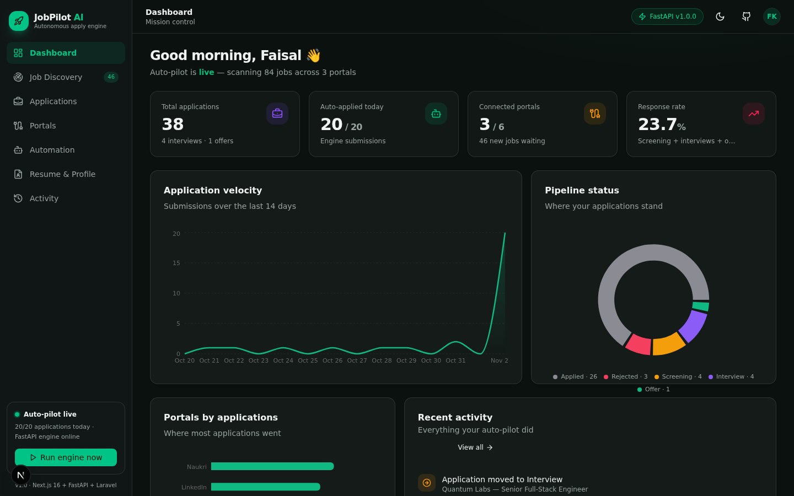 | 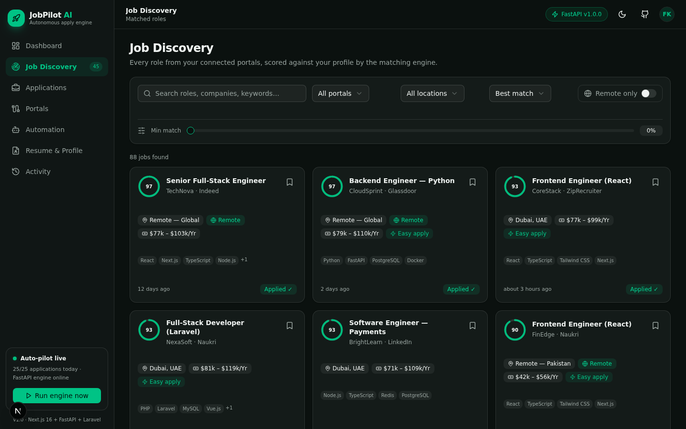 |
| **Applications** | **Portals** |
| 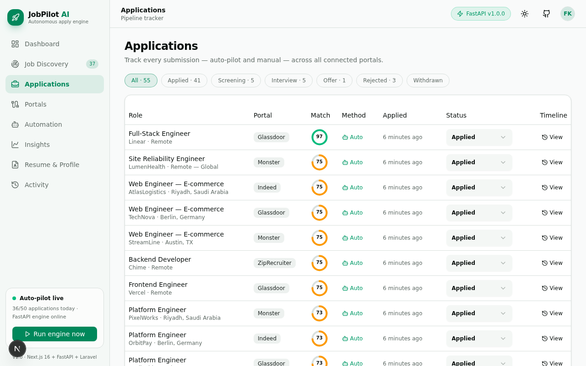 | 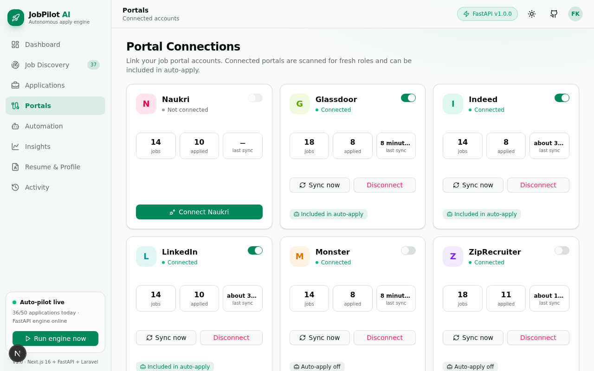 |
| **Automation** | **Resume Studio** |
| 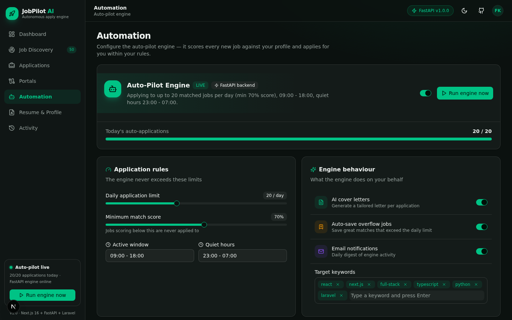 | 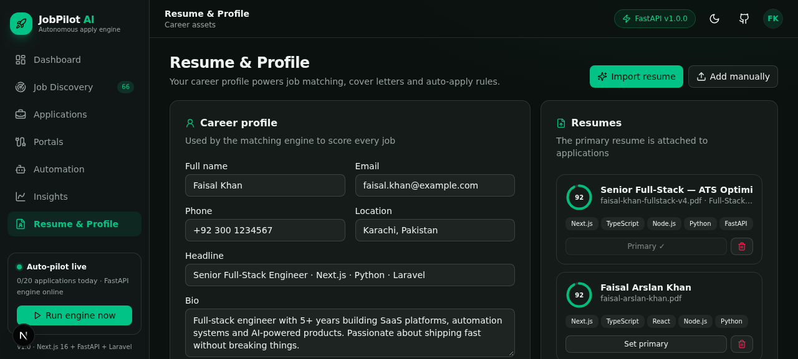 |
| **Performance Insights** | **Activity Audit Log** |
| 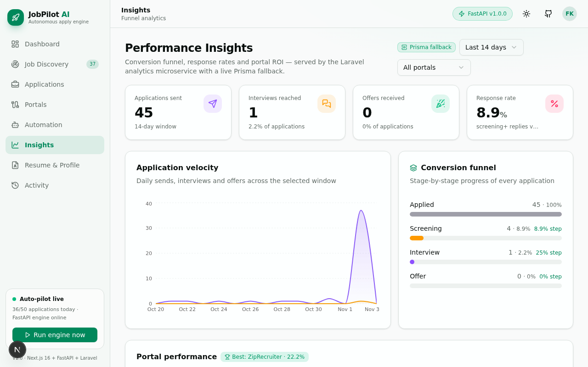 | 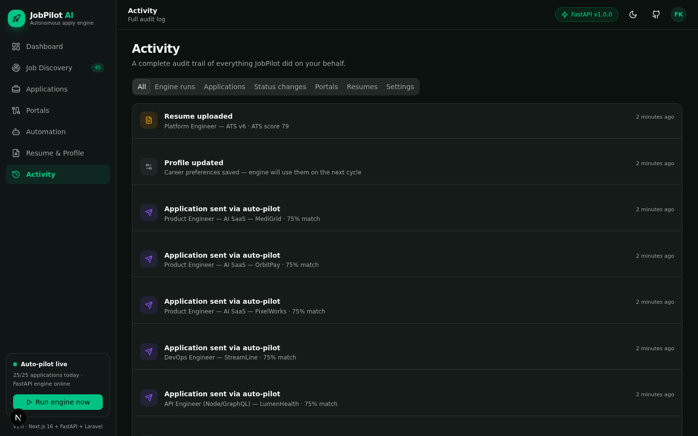 |

*Fully responsive — light & dark themes:*

| Light Theme | Mobile |
| :---: | :---: |
| 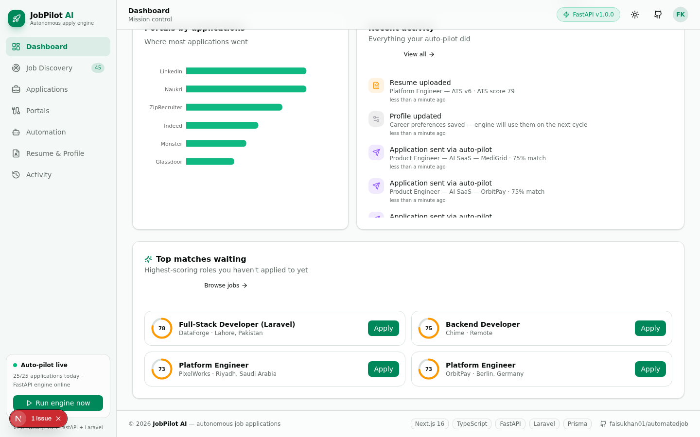 | 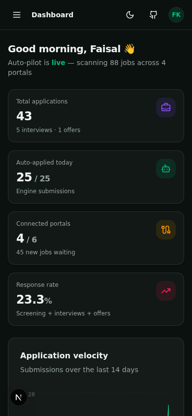 |

</div>

## 🏗️ Architecture

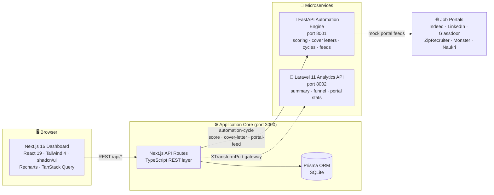

**The auto-pilot loop:** every engine run pulls open jobs from the database, ships them to the
FastAPI service for scoring + cover-letter generation, applies to everything above your match
threshold (up to the daily limit), auto-saves the overflow, and records the whole cycle in the
audit log. If the Python service is ever offline, a mirror of the same scoring algorithm runs
in-process — the platform **never stops working**.

## 🧱 Tech Stack

| Layer | Technology |
|---|---|
| **Frontend** | Next.js 16 (App Router), React 19, TypeScript 5, Tailwind CSS 4, shadcn/ui, Recharts, Framer Motion, TanStack Query, Zustand, next-themes, sonner |
| **Core API** | Next.js Route Handlers (REST), Prisma ORM, SQLite |
| **Automation Engine** | Python 3.12, FastAPI, Pydantic, Uvicorn |
| **Analytics API** | Laravel 11, PHP 8.2 (stateless REST microservice) |
| **Tooling** | Bun, ESLint 9, Prisma Migrate/Push |

## 🚀 Quick Start

> **Prerequisites:** Node 20+ / Bun, Python 3.12, (optional) PHP 8.2 + Composer for the analytics service.

### 1️⃣ Main dashboard — Next.js (port 3000)

```bash
bun install
cp .env # ensure DATABASE_URL=file:./db/custom.db — see .env.example
bun run db:push          # create tables
bun prisma/seed.ts       # seed 6 portals, 80+ jobs, applications & activity
bun run dev              # http://localhost:3000
```

### 2️⃣ Automation engine — Python FastAPI (port 8001)

```bash
cd mini-services/automation-engine
pip install -r requirements.txt
bun run dev              # uvicorn with auto-reload
# → http://localhost:8001/health
```

### 3️⃣ Analytics API — Laravel 11 (port 8002, optional)

```bash
cd mini-services/analytics-api
composer install
cp .env.example .env
php artisan key:generate
php artisan serve --port=8002
# → http://localhost:8002/api/health
```

## 📡 API Reference

### Core REST API (Next.js, port 3000)

| Method | Endpoint | Description |
|---|---|---|
| `GET` | `/api/overview` | Dashboard aggregate: totals, series, pipeline, portals, recent activity |
| `GET` | `/api/portals` | List portals with status, sync time, job counts |
| `POST` | `/api/portals` | Portal actions: `connect` · `disconnect` · `sync` · `toggle-auto` |
| `GET` | `/api/jobs` | Search jobs — `q`, `portal`, `location`, `remote`, `minMatch`, `minSalary`, `sort` |
| `PATCH` | `/api/jobs/:id` | Save / unsave or dismiss a job |
| `GET` | `/api/applications` | List applications (filter by `status`) |
| `POST` | `/api/applications` | Apply manually to a job — cover letter auto-generated |
| `PATCH` | `/api/applications/:id` | Move application through the pipeline |
| `GET/PUT` | `/api/profile` | Career profile powering the matching engine |
| `GET/POST` | `/api/resumes` · `PATCH/DELETE /api/resumes/:id` | Resume management + primary selection |
| `GET/PUT` | `/api/automation` | Auto-pilot configuration |
| `GET` | `/api/activity` | Full audit log |
| `GET/POST` | `/api/engine` | Engine health · **run an auto-pilot cycle now** |

### Automation Engine (FastAPI, port 8001)

| Method | Endpoint | Description |
|---|---|---|
| `GET` | `/health` | Liveness + uptime |
| `POST` | `/score-jobs` | Score jobs against a profile (transparent reasons included) |
| `POST` | `/cover-letter` | Generate a tailored cover letter |
| `POST` | `/automation-cycle` | Full cycle: score → filter → select → generate letters |
| `GET` | `/portal-feed/:slug` | Mock portal job feed (6 portals) |

### Analytics API (Laravel, port 8002)

| Method | Endpoint | Description |
|---|---|---|
| `GET` | `/api/health` | Service health |
| `GET` | `/api/analytics/summary` | Totals, response rate, by-portal, by-day |
| `GET` | `/api/analytics/funnel` | Applied → screening → interview → offer conversion |
| `GET` | `/api/analytics/portals` | Per-portal performance + best portal |

## 🤖 How the Auto-Pilot Works

```text
 1. You connect portals (Indeed, LinkedIn, …) and set rules:
      daily limit, min match score, active hours, keywords.
 2. Click "Run engine now" (or the scheduler triggers a cycle).
 3. Open jobs are pulled from the DB and sent to FastAPI:
      → skills overlap (48 pts) + role fit (22) + salary fit (15)
        + location/remote fit (12) = transparent 0-100 score.
 4. Jobs scoring ≥ your threshold get an AI-generated cover letter
      and an application is submitted — until the daily limit.
 5. Overflow high-matches are auto-saved; everything is logged.
 6. You wake up to new screening invites. ☕
```

## 📁 Project Structure

```text
automatedjob/
├── src/
│   ├── app/
│   │   ├── api/                  # REST layer (overview, portals, jobs, applications, engine, …)
│   │   ├── layout.tsx            # theme + providers
│   │   └── page.tsx              # dashboard entry
│   ├── components/
│   │   ├── jobpilot/             # app shell, sidebar, topbar, footer, 7 feature views
│   │   └── ui/                   # shadcn/ui primitives
│   └── lib/                      # db client, api hooks, matching, engine client, store
├── prisma/                       # schema + rich seed data
├── mini-services/
│   ├── automation-engine/        # 🐍 Python FastAPI (port 8001)
│   └── analytics-api/            # 🐘 Laravel 11 (port 8002)
├── docs/                         # banner, logo, screenshots
└── scripts/                      # asset generation
```

## 🗺️ Roadmap

- [ ] Real browser-session scraping for portal feeds (Playwright worker)
- [ ] GPT-powered cover-letter styles (concise / storytelling / technical)
- [ ] Interview reminder calendar + email digests
- [ ] Multi-user auth (NextAuth) with per-account portals
- [ ] Laravel analytics wired to the shared SQLite/Postgres DB
- [ ] Recruiter-response prediction model

## 🤝 Contributing

PRs are welcome! Fork → branch (`feat/...`) → commit → open a PR.
For major changes, open an issue first to discuss what you'd like to build.

## 📄 License

Distributed under the **MIT License**. See [`LICENSE`](LICENSE) for details.

---

<div align="center">

**Built with ❤️ + ☕ by [faisukhan01](https://github.com/faisukhan01)**

⭐️ *Star the repo if JobPilot lands you your next interview!*

</div>
